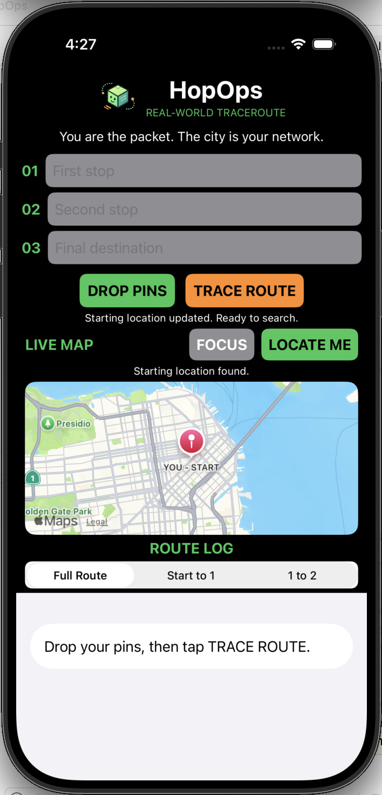
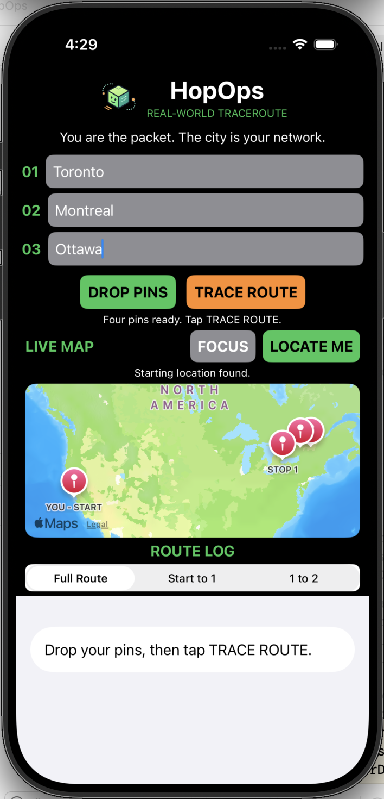
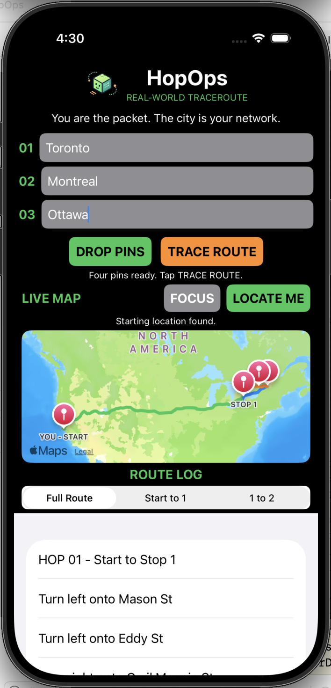
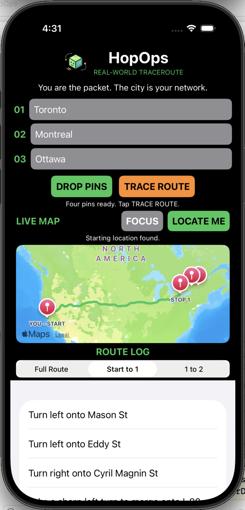
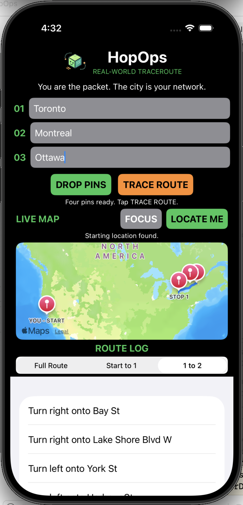

# HopOps 📦

**You are the packet. The city is your network.**

What if planning a road trip felt a little like running a traceroute?

HopOps is a playful iOS route planner that turns real-world destinations into network hops. Pick two relay stops, choose your final endpoint, and trace your journey across an interactive map.

Built with SwiftUI and MapKit, it brings a little networking personality to everyday navigation.

## A Trip in Five Frames

From a single starting point to a complete multi-hop journey.

### 01 — Locate. 02 — Drop pins. 03 — Trace route.

| 01 · Find Your Origin | 02 · Drop Your Pins | 03 · Trace the Journey |
| :---: | :---: | :---: |
|  |  |  |
| Find your starting position using GPS. | Set two stops and a final destination. | Calculate all three legs and follow the route log. |

### 04 — Inspect individual hops

Not every journey needs the whole picture. Switch between individual route segments to inspect their directions and paths.

| Start to Stop 1 | Stop 1 to Stop 2 |
| :---: | :---: |
|  |  |
| Follow the first hop from your current location. | Explore the next relay between your stops. |

## Features

- **Live GPS origin** — Start from your device's current location.
- **Multi-stop planning** — Search for two relay stops and one final destination.
- **Drop pins** — Plot your starting point and three locations on an interactive map.
- **Colour-coded routes** — Visualize each driving leg with its own route line.
- **Route log** — Browse turn-by-turn directions for the full journey or individual hops.
- **Focus controls** — Re-centre the map after exploring somewhere else.
- **Error handling** — Handle invalid searches, unavailable routes, and changed destinations.

## Under the Hood

| Technology | Purpose |
|---|---|
| Swift | Application logic |
| SwiftUI | Native iPhone interface |
| MapKit | Maps, geocoding, markers, and driving directions |
| Core Location | GPS positioning and location permissions |

HopOps calculates three driving legs:

```text
YOU (START)
    |
    v
HOP 01 -- Stop 1
    |
    v
HOP 02 -- Stop 2
    |
    v
HOP 03 -- Destination
```

Each leg returns its own directions. HopOps combines them into the full route log while keeping the first two legs available for individual inspection.

## Getting Started

1. Clone the repository.
2. Open `HopOps.xcodeproj` in Xcode.
3. Select an iPhone simulator or device running iOS 17 or later.
4. Build and run HopOps.
5. Allow location access and tap **LOCATE ME**.
6. Enter your first stop, second stop, and final destination.
7. Tap **DROP PINS** to find your locations.
8. Tap **TRACE ROUTE** to calculate your journey.
9. Switch between **Full Route**, **Start to 1**, and **1 to 2** to explore the directions.

For simulator testing, set a simulated GPS location through Xcode or the iOS Simulator.

An internet connection is required for location searches, map data, and route calculations.

## Why HopOps?

In networking, a traceroute reveals the hops a packet takes to reach its destination.

HopOps takes that concept out of the terminal and into the real world.

Your device is the starting node. Your stops are relay nodes. Your destination is the final endpoint.

No real packet sniffing or network tracing is involved. Just a fun way to explore routes through a networking-inspired interface.

---

*Built for the fun of making things.*
